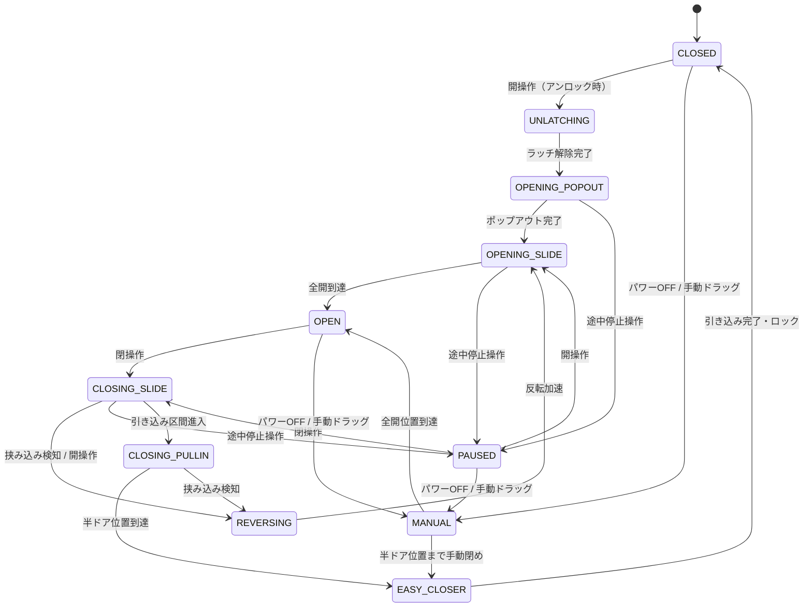

# バーチャル・ミニバン スライドドア Webアプリ 設計書

## 1. プロジェクト概要・コンセプト

### 1.1 目的
ミニバンなどのパワースライドドアが大好きな子どもが、**「ただスライドドアを開け閉めするだけ」**を何度でも心ゆくまで楽しめるWebアプリを制作する。  
ゲーム性や派手な演出を足すのではなく、**「本物のミニバンのスライドドアを操作しているかのような徹底的なリアルさ」**を最優先に追求する。

### 1.2 想定ユーザー
- **メインユーザー**: スライドドアが好きな子ども（幼児〜小学校低学年を想定）
- **サブユーザー**: そばで見守る保護者（音量調整・昼夜やボディカラー切替・ロック設定などを操作）

### 1.3 「リアルさ」を構成する4つの柱
実車のスライドドアに子どもが惹きつけられる要素を分解し、以下4軸を徹底的に再現する。

1. **物理軌道と機構のリアルさ**
   - 単純な横スライドではなく、閉じた状態（ボディとツライチ）から**「斜め外側にせり出す（ポップアウト）」→「ボディに沿って後方へスライド」→「ストッパーで柔らかく停止」**という実車特有の3次元軌道。
   - 閉じ際の**「ボディ側へ引き込まれる動き」**と、半ドア位置からモーターで静かに引き込む**「イージークローザー」**。
   - ボディ側面（リアクォーターパネル）の**センターレール溝**と、ドアを支える**ローラーアーム（ヒンジ機構）**の連動動作。
2. **音響のリアルさ**
   - 操作音・警告ブザー（ピピッ／ピ・ピ・ピ…）、電子ラッチ解除音（ガチャッ）、速度に応じてピッチが変化するモーター駆動音（ウィーン）、レール走行音、イージークローザー音（ウィィン…バタン）、ハザードリレー音（カッチ・カッチ）をリアルタイム同期。
3. **操作体系のリアルさ**
   - アウターハンドル、スマートキー（リモコン）、運転席オーバーヘッドスイッチ、車内Bピラーボタン、インナーハンドル、ハンズフリーキックセンサー、さらにパワーOFF時の**手動ドラッグ開閉**まで実車そのままの操作系を用意。
4. **視覚・光のリアルさ**
   - クリアコート塗装の映り込み、プライバシーガラス、ドア開閉に連動する**ハザード点滅（アンサーバック）**、**ルームランプのじわっと点灯／残光消灯**、足元ウェルカムランプ、昼・夕方・夜のライティング変化。

---

## 2. 要件定義

### 2.1 コア機能：スライドドアの状態遷移と挙動

スライドドアの挙動は単なる「開／閉の2状態アニメーション」ではなく、以下の詳細な状態マシン（Finite State Machine）と連続パラメータ $p \in [0, 1]$（0 = 全閉、1 = 全開）で制御する。



- **途中停止・反転**: 開閉途中にボタンやハンドルを操作すると、警告音（ピッ）とともに停止、または逆方向へ動作する（設定で挙動選択可）。
- **半ドア＆イージークローザー**: 手動モードでドアを閉めきらずに手前（開度約 5〜8% 付近）まで近づけると、カチッと半ドアラッチがかかり、自動でイージークローザーが作動して完全に閉まる。

### 2.2 操作インターフェース（開閉トリガー）

| 操作箇所 | 実車での操作 | アプリでの操作・再現内容 |
| :--- | :--- | :--- |
| **アウタードアハンドル** | 引く / ワンタッチスイッチを押す | 車体のドアハンドルを直接タップまたは軽く引く。ハンドル自体も物理的に手前へ動く |
| **スマートキー（リモコン）** | スライドドアボタン長押し（または2回押し） | 画面隅に配置できるリアルなスマートキーUI。施錠・解錠・開閉ボタンとLED点灯、ハザード連動アンサーバック |
| **運転席スイッチ** | オーバーヘッド／インパネの開閉スイッチ＋MAINスイッチ | 開閉ボタンに加え、**パワースライドドア MAIN ON/OFF** 切替を搭載（OFF時は手動モードになる） |
| **車内操作（Bピラー／インナーハンドル）** | 車内のBピラーボタン押下／内側ハンドル操作 | 車内視点に切り替え、車内側から開閉。ドアが開くと外の景色と光が入ってくる |
| **ハンズフリー（キックセンサー）** | スライドドア下部に足をかざす | サイドシル下部のセンサー領域をタップ／スワイプすると、センサー反応音＋ブザー後に自動開閉 |
| **手動ドラッグ（パワーOFF時）** | ドアを直接手で引っ張る・押す | 指／マウスでドアを直接スライド。勢いよく閉めると「バタン！」、そっと閉めるとイージークローザーが発動 |

### 2.3 リアルさを高めるギミック＆演出

- **挟み込み防止機能（アンチピンチ）**
  - ドアが閉まっている最中にドア前端（エッジ部分）をタップするか、障害物テストボタン（ぬいぐるみ／手アイコン等）を置くと、接触を検知して**「ピーッピーッピーッ！」**と警告音を鳴らし、即座に反転して全開になる。
- **ドアロック / チャイルドロック**
  - スマートキーで施錠（ロック）した状態でアウターハンドルを引くと、ハンドルがガチャッと動くだけで開かない（チャイルドロック時は車内インナーハンドルのみ無効化）。
- **ライティング連動演出**
  - **ハザードランプ（アンサーバック）**: リモコン施錠で1回、解錠で2回、スライドドア開閉開始時に点滅。
  - **ルームランプ＆ウェルカムランプ**: ドアが開き始めると車内LEDと地面を照らすステップランプが**じわっと点灯**し、全閉後は数秒の**残光（フェードアウト）**を経て消灯。
- **電動格納ステップ（オプションON/OFF）**
  - ドアの開閉に連動してサイドシル下から電動ステップがせり出し・格納される。
- **バリエーション切替（好み合わせ）**
  - **ボディカラー**: パールホワイト、ブラックメタリック、シルバー、ダークブルー、レッド等（クリアコート質感付き）。
  - **時間帯・環境**: 昼（屋外青空）／夕方（サンセット）／夜（街灯＋車内灯とハザードが映える）。
  - **ブザー・チャイム音色**: 国産ミニバン定番の複数パターン（電子ブザー系／やわらかチャイム系など）を切替可能。

### 2.4 カメラ・視点プリセット

子どもが好きな角度から何度でも眺められるよう、スムーズなカメラ補間付きで以下を切り替える。

1. **サイドビュー（真横）**: ドア全体の開閉と開口部の広さが見やすい標準視点。
2. **フロント3/4（斜め前）**: ドアがボディから外側へポップアウトする動き・ステップ・車内シートがよく見える視点。
3. **リア3/4・レールアップ（斜め後ろ）**: センターレールの溝とローラーアームが動くメカ好き向け視点。
4. **車内ビュー（2列目シート視点）**: 車の中からドアの開閉と外の景色を眺める視点（Bピラーボタン・インナーハンドル操作対応）。
5. **フリーオービット**: 1本指ドラッグ（または所定操作）で好きな角度から観察可能（ドアの手動ドラッグと競合しないよう操作領域を分離）。

### 2.5 非機能要件（子ども向けUX・品質）

- **対応デバイス**: iPad / タブレット（横・縦）、スマートフォン（縦・横）、PCブラウザ。
- **パフォーマンス**: モバイル端末でも **60fps** の滑らかな動作（3Dモデルのポリゴン数・シェーダー負荷・シャドウマップ解像度を最適化）。
- **子ども向け安全UX**:
  - ピンチズーム、ダブルタップズーム、テキスト選択、長押しメニューを無効化（`touch-action: none`, `user-select: none`）。
  - メイン画面は文字を最小限にし、実車パーツや直感的なアイコン（実物風ボタン）だけで遊べる構成。
  - **保護者用設定パネル**: 設定アイコンの長押し（例：1.5〜2秒）で開くモードを用意し、子どもが意図せず設定画面に迷い込むのを防止。
  - 音量スライダー・即ミュートボタンを備え、外出先でも安心。
- **PWA / オフライン対応**: ホーム画面に追加すればフルスクリーンでネイティブアプリのように起動し、オフラインでも動作。外部通信・広告・トラッキングは一切なし。

---

## 3. 技術要素・技術スタック選定

### 3.1 描画方式の比較と選定

| 方式 | メリット | デメリット | 評価 |
| :--- | :--- | :--- | :--- |
| **3D WebGL (Three.js + React Three Fiber)** | ・ポップアウトの3次元軌道とレール機構を物理的にそのまま再現可能<br>・複数カメラ視点（外・斜め・車内・レールアップ）が自在<br>・PBRクリアコート塗装、環境反射、昼夜ライト、ルームランプのリアルな光表現<br>・カラー変更やステップ追加が容易 | ・3D車両の造形クオリティを作り込まないとチープ（箱型）に見えやすい<br>・端末性能に応じた最適化が必要 | **◎ 採用推奨** |
| **2D Canvas / SVG** | ・軽量、実装がシンプル | ・奥行き（ポップアウトの立体感）や視点切替、リアルな塗装反射・車内視点の表現に限界がある | △ 不向き |
| **実写連番画像 / 動画スプライト** | ・見た目は実車そのもの | ・途中停止・手動ドラッグ・挟み込み反転・カラー変更・昼夜・複数視点の組み合わせでデータ量が爆発しインタラクティブ性が低下 | △ 不向き |

#### 3Dモデルの「リアルさ」を担保する戦略
手続き的（Procedural）に雑な直方体を並べるとおもちゃっぽくなるため、以下のアプローチで**実車感のある高精細3D表現**を実現する。

1. **曲面ボディの精密モデリング（高精度プロシージャル or 自作GLB）**:
   - スプライン断面押し出し（Extrude / Loft）＋スムース法線＋面取り（Bevel）により、ミニバン特有のフロントノーズ、A/B/C/Dピラー、キャラクターライン、ホイールアーチ、パネルの隙間（チリ・シャットライン）まで丁寧に造形する。
   - **GLBアセットローダー対応アーキテクチャ**を採用し、デフォルトの高精細ビルトインモデルに加え、将来的にBlender等で作成した実車風 `.glb` モデルにも差し替え可能にする。
2. **自動車向けPBRマテリアル＋環境マップ（IBL）**:
   - `MeshPhysicalMaterial` の `clearcoat: 1.0`, `clearcoatRoughness: 0.05`, `metalness`, `roughness` により自動車特有の艶と映り込みを再現。
   - プロシージャル生成のスタジオ／屋外HDRI風環境マップ（`RoomEnvironment` / カスタム `PMREMGenerator`）を適用し、外部ネットワーク不要でリアルな映り込みを実現。
3. **「見せ場」の重点ディテール**:
   - センターレール溝、上部・中央・下部ローラーアーム、ドア内張り（トリム）、ゴムウェザーストリップ、クロームメッキハンドル、LEDヘッドライト／テールランプ／ウインカー、2列目キャプテンシート（アームレスト・オットマン付き）、乗降グリップ、フロアステップを重点的に作り込む。

### 3.2 推奨技術スタック

| 領域 | 採用技術 | 選定理由 |
| :--- | :--- | :--- |
| **フロントエンド基盤** | **React 19 + TypeScript + Vite** | 型安全な状態管理と高速な開発・ビルド。PWA化も容易 |
| **3D描画エンジン** | **Three.js + `@react-three/fiber` + `@react-three/drei`** | Reactと宣言的に統合でき、カメラ補間・環境マップ・タッチレイキャストが扱いやすい |
| **状態管理** | **Zustand** | React再レンダリングを起こさず `useFrame` (60fps) 内から直接状態参照・更新が可能 |
| **音響エンジン** | **Web Audio API（自前シンセ＋必要に応じ軽量WAV/MP3）** | ドア速度に応じたモーター音ピッチ連続変化や、遅延ゼロのブザー・ラッチ・リレー音再生が可能 |
| **UIスタイリング** | **Tailwind CSS** | レスポンシブかつスキューモーフィックなリアル車載スイッチUIを素早く構築可能 |
| **PWA化** | **`vite-plugin-pwa`** | iPad / スマホでのホーム画面追加・オフラインキャッシュ対応 |

### 3.3 音響エンジン設計（Web Audio API）

「音のリアルさ」がこのアプリの満足度を大きく左右するため、ドアの物理状態と1フレーム単位で連動する専用オーディオエンジン `DoorAudioEngine` を構築する。

- **モバイル音声アンロック**: iOS Safari / Android Chrome の制約に対応し、最初のタッチイベントで `AudioContext.resume()` を確実に実行。
- **サウンドレイヤー構成**:
  1. **警告ブザー／チャイム層**: 矩形波／三角波＋バンドパスフィルタで車載圧電ブザー特有の倍音（約 2.1kHz〜2.4kHz）と減衰エンベロープを再現。「ピピッ（開始）」「ピ・ピ・ピ…（閉動作）」「ピーッピーッピーッ（挟み込み）」を鳴らし分け。
  2. **メカニカルラッチ層**: 短時間のノイズバースト＋低域パンチ音＋金属共振フィルタで「ガチャッ（解除）」「カチッ（半ドア）」「ドスッ／バタン（全閉・衝撃速度に比例して音量・ローパス変化）」。
  3. **パワースライドモーター層**: 複数オシレータ（基本波＋ギア噛み合い高調波）をドア速度 $|v|$ に連動させ、起動時の立ち上がり・定速巡航・減速停止のピッチとゲインをリアルタイム変調。
  4. **レール走行音層**: ローパス＋バンドパスを通したピンクノイズに微細な周期変調を加え、ローラーがレール上を転がる「ゴロゴロ／シャーッ」という質感を速度連動で生成。
  5. **イージークローザー層**: 低速高トルクのウォームギアモーター音（低めの「ウィィィン…」）→ ウェザーストリップ圧縮音 → 施錠クリック音の一連シーケンス。
  6. **ハザードリレー＆アンサーバック層**: ウインカー点滅タイミングと完全同期する「カッチ…カッチ…」およびキーロック音「ピッ／ピピッ」。

### 3.4 物理・キネマティクス設計（軌道数理モデル）

ドアの進行度 $p \in [0, 1]$（0 = 全閉ツライチ、1 = 全開）から、ドア本体の3次元姿勢とローラーアームの関節角度を一意に計算するキネマティクス関数を定義する。

- **軌道フェーズ分割**:
  - **Phase A: ポップアウト / 引き込み区間（$p \in [0, 0.14]$）**
    - 外側変位 $x(p)$: シグモイド／エルミート曲線で $0 \to +0.11\text{m}$ へ滑らかにせり出す。
    - 後方移動 $z(p)$: せり出しと同時に緩やかに後方へ移動開始。
    - ヨー角 $\theta(p)$: ドア後端が先に外へ出る実車特有の微小な首振り角（最大約 2.5〜3.5°）を付与し、ポップアウト完了時に 0°（ボディと平行）へ戻る。
  - **Phase B: 平行スライド区間（$p \in [0.14, 1.0]$）**
    - 外側変位 $x(p) = +0.11\text{m}$（一定）、ヨー角 $\theta(p) = 0^\circ$。
    - 後方移動 $z(p)$: 全開ストローク（約 $0.78\text{m}$〜$0.85\text{m}$）まで直線移動。
- **速度プロファイル（電動モード）**:
  - 台形速度制御＋S字ジャーク制限（立ち上がり・停止時になめらかな加減速）。
  - 開ききり・閉めきり直前の減速、およびストッパー到達時のごくわずかな弾性ダンピング（バネ・減衰振動）で「重みのあるドア感」を演出。
- **手動モードの物理モデル**:
  - ドアの等価質量 $m$、レール転がり摩擦 $\mu$、ドラッグ入力による外力 $F$ を用いた1次元運動方程式で更新。
  - 勢いよく押して離すと慣性で滑走し、終端ストッパーに当たると速度に応じた音量・微振動が発生。
  - 閉方向で $p < 0.07$ に低速で進入すると、自動的に `EASY_CLOSER` 状態へ遷移して引き込みが完了する。

---

## 4. アーキテクチャ・設計方針

### 4.1 ディレクトリ構成案

```text
virtual_slide_door/
├── DESIGN.md                     # 本設計書
├── index.html
├── package.json
├── vite.config.ts                # Vite + PWA設定
└── src/
    ├── main.tsx
    ├── App.tsx
    ├── store/
    │   └── useDoorStore.ts       # Zustandストア（ドア状態・設定・カメラ・ロック・照明）
    ├── simulation/
    │   ├── doorKinematics.ts     # 進行度p -> 3D座標・ヨー角・ローラーアーム姿勢計算
    │   ├── doorStateMachine.ts   # 状態遷移・電動速度制御・手動物理・挟み込み検知
    │   └── types.ts              # 状態・設定の型定義
    ├── audio/
    │   ├── DoorAudioEngine.ts    # Web Audio API 統合管理・アンロック・音量制御
    │   └── synths/               # ブザー・モーター・ラッチ・イージークローザー・リレー音源
    ├── scene/
    │   ├── MinivanScene.tsx      # Three.js Canvas・環境・ライティング・カメラ制御
    │   ├── CameraRig.tsx         # 視点プリセット補間＋フリーオービット制御
    │   ├── EnvironmentRig.tsx    # 昼・夕方・夜ライティング・地面・背景演出
    │   └── models/
    │       ├── MinivanBody.tsx   # 車体ボディ・ガラス・ランプ・タイヤ・センターレール溝
    │       ├── SlidingDoor.tsx   # スライドドア本体・アウター/インナーハンドル・エッジ判定
    │       ├── RollerArmMechanism.tsx # 上/中/下ローラーアーム連動機構
    │       ├── MinivanInterior.tsx    # 2列目/3列目シート・Bピラーボタン・ルームランプ
    │       └── PowerStep.tsx     # 電動格納ステップ
    └── components/
        ├── HudOverlay.tsx        # 最小限の視点切替・ミュート・モード表示
        ├── SmartKeyFob.tsx       # 実物風スマートキーUI（開閉・ロック・LED）
        ├── CockpitSwitchPanel.tsx# 運転席オーバーヘッド風スイッチ（開閉・MAIN ON/OFF）
        ├── ObstacleControl.tsx   # 挟み込み防止テストUI（任意トグル）
        └── ParentSettingsModal.tsx # 保護者向け設定（長押し起動・カラー・音色・時間帯等）
```

### 4.2 60fps シミュレーションループとUIの分離方針

- **ホットパス（毎フレーム更新）**: ドア位置 $p$、速度 $v$、ランプ輝度、ハザード点滅、カメラ補間、オーディオ変調はすべて React の state ではなく **Zustand のミュータブル参照 / `useFrame` コールバック内** で直接更新する。これにより、開閉中に React コンポーネントが無駄に再レンダリングされるのを防ぎ、タブレット・スマホでも 60fps を安定維持する。
- **コールドパス（離散イベント）**: 状態ラベルの変化（`CLOSED` → `OPENING_POPOUT`）、ロック状態、カラー変更、視点切替など離散イベントのみ React UI に購読させ、スマートキーLEDやスイッチ表示を更新する。

### 4.3 UI/UX 設計方針（子どもファースト）

1. **「車そのものがUI」**
   - 画面の 85〜90% を3Dミニバン表示に割り当て、画面上のドアハンドル・ドア本体・足元・Bピラーボタンを**直接触って動かせる**ことを最優先にする。
2. **本物そっくりのサブ操作パネル（スキューモーフィズム）**
   - 画面右下（または左/下配置、縦横画面対応）に、本物のスマートキーを模した操作パネルを配置。
   - 必要に応じて運転席スイッチパネルを展開・折りたたみ可能。
3. **わかりやすい視覚・聴覚フィードバック**
   - 子どもは文字を読めない前提で設計し、ボタンはすべて実車と同じピクトグラム（スライドドア開閉アイコン・鍵アイコン・電源アイコン・太陽/月アイコン・カメラアイコン）で表現。
   - タップ可能な実車パーツには、初回のみ控えめなガイド（任意ON/OFF）を出せるようにし、普段は実車そのままの見た目を損なわない。

---

## 5. 開発ロードマップ（段階的実装）

### Phase 1: MVP（まずは「開け閉めの感動」を完成させる）
- Vite + React + TypeScript + Three.js (`@react-three/fiber`) + Zustand プロジェクト構築
- 高精細プロシージャル3Dミニバン（ボディ、ホイール、ガラス、センターレール溝、2列目内装、スライドドア、ローラーアーム）
- ポップアウト＋平行スライド＋引き込み＋イージークローザーの3次元物理軌道＆状態マシン
- Web Audio API による基本サウンド一式（ブザー、ラッチ解除、速度連動モーター音、レール音、イージークローザー音）
- アウターハンドル直接タッチ＋実物風スマートキーUI＋基本カメラ視点切替（真横・斜め前・レールアップ）

### Phase 2: インタラクション＆ギミック深化
- 運転席スイッチパネル（MAIN ON/OFF）と**手動ドラッグ開閉＋半ドアイージークローザー**
- **車内視点（2列目）**＋Bピラーボタン／インナーハンドル操作
- **挟み込み防止機能**（ドアエッジタッチ／障害物テストで警告音＆自動反転）
- **ライティング連動**（ハザードアンサーバック＆リレー音、ルームランプ残光点灯、ウェルカムランプ）
- **ドアロック / チャイルドロック**＆**ハンズフリーキックセンサー**

### Phase 3: こだわり表現＆子ども向け仕上げ
- 時間帯切替（昼・夕方・夜）とリアルな夜間ライティング
- ボディカラー切替・ブザー音色パターン切替・電動格納ステップ
- 保護者向け設定メニュー（長押しアンロック）・音量調整
- タブレット／スマホ向けレスポンシブ最適化・PWA対応（オフライン動作・フルスクリーン）

---

## 6. 確定した仕様・重点方針（ヒアリング反映）

ヒアリング結果を反映し、以下を本アプリのコア仕様として確定する。

1. **車種イメージ：日産 セレナ系（C27 / C28 世代テイスト）**
   - ワイドなVモーショングリル＋横基調LEDデイライト／ヘッドライト、特徴的なシュプールライン（前席側が一段下がるサイドウィンドウライン）、ブラックアウトピラーによるフローティングルーフ表現、縦基調LEDテールランプを再現。
   - **ワンタッチオートスライドドア**: クロームアウターハンドルに埋め込まれた**ワンタッチスイッチ（黒い丸・楕円ボタン）**を再現し、タップ1回で開閉可能（ハンドルを引く操作にも対応）。
   - **ハンズフリーオートスライドドア**: スライドドア前端下部（Bピラー付近）にキックセンサーを配置。
   - **インテリジェントキー風スマートキーUI**: 施錠・解錠・パワースライドドアボタン＋赤色LEDインジケーター。
   - ボディカラー：プリズムホワイト（2トーンブラックルーフ対応）、ダイヤモンドブラック、ターコイズブルー、ダークメタルグレー、カーディナルレッド等を収録。
2. **最優先の見せ場：「外から閉まる瞬間」の極上のリアルさ＋全機能フル実装**
   - デフォルト視点を**「外から閉まる動きが最も美しく見える斜め前（フロント3/4寄りサイド）」**に設定。
   - 閉じ動作のハイライト（警告ブザー＆ハザード連動 → センターレール前進 → 引き込みカーブで車体側へ吸い込まれる動き → 半ドア「カチッ」→ イージークローザー「ウィィィン…ドスッ！」でツライチ密着 → ルームランプ残光フェードアウト）をフレーム単位で徹底的に作り込む。
   - 「基本的に全部好き」というニーズに応え、Phase 1〜3の主要機能（手動ドラッグ開閉、車内2列目視点＆Bピラーボタン、挟み込み防止、キックセンサー、電動ステップ、ドアロック、昼/夕方/夜切替、カラー・音色切替）を一貫して実装する。
3. **メインターゲット端末：スマートフォン（モバイルファースト）**
   - **縦持ち・横持ち両対応**で、アスペクト比に応じて3Dカメラの距離・FOVを自動調整し、スマホ縦画面でも車体全体とドアのせり出し・引き込みが画面いっぱいに見やすく収まる設計にする。
   - 縦画面時は「上部〜中央に3D実車ビュー、下部に片手・幼児でも押しやすい大型リアル操作パネル（スマートキー／運転席スイッチ／ギミック切替）」を配置。
   - モバイルGPUでも滑らかに60fps動作するよう、`dpr` 上限設定・軽量シャドウ・プロシージャル環境マップを採用し、iOS Safari / Android Chrome での初回タッチ音声アンロックを確実に行う。

